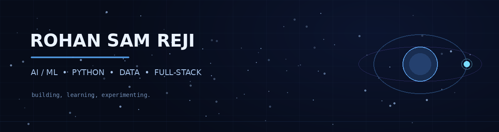

 

## `whoami`

I'm Rohan, an M.Sc. Artificial Intelligence & Machine Learning student interested in turning concepts into practical projects. I'm strengthening my foundations across programming, data analysis, machine learning, databases and web development.

## `currently_exploring`

- Artificial Intelligence and Machine Learning
- Python programming and data analysis
- ML workflows, model building and evaluation
- SQL and database technologies
- Full-stack web development
- Practical applications of AI tools and cloud technologies

## `tech_stack`

  
  
  

## `github_stats`

 

## `featured_work`

I'm using GitHub to document my learning and build projects across AI/ML, data, databases and full-stack development.

**Explore my repositories:** [github.com/rohansamreji-sys](https://github.com/rohansamreji-sys?tab=repositories)

> Pin 4–6 of your strongest repositories on your profile. For each one, add a clear README, screenshots, features and setup instructions.

## `connect`

- GitHub: [@rohansamreji-sys](https://github.com/rohansamreji-sys)
- Location: Bengaluru, India

midnight mode: on · always learning, always building

